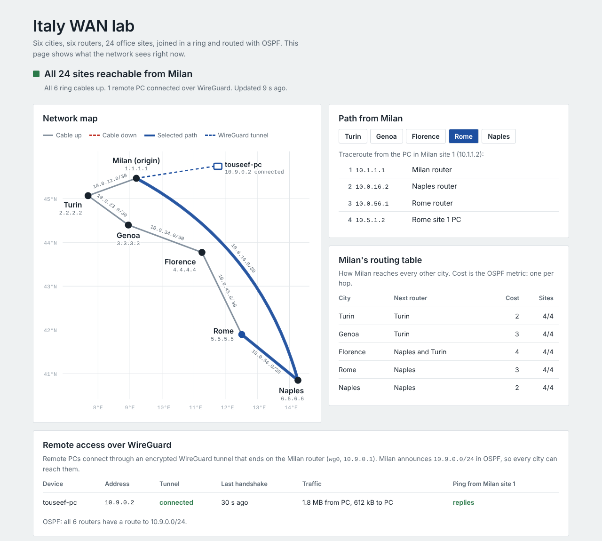

# Italy WAN lab

A six city company network running OSPF. I first built it by hand in Cisco Packet Tracer, then rebuilt it as code with containerlab and FRRouting on a cloud server, keeping the same addresses, ports and OSPF design.

[](https://wan.touseefahmed.com)

**Live status page: [wan.touseefahmed.com](https://wan.touseefahmed.com)**. The map, paths, routing table and reachability of every site, refreshed every 15 seconds.

```
   Milan (1) ──── Turin (2) ──── Genoa (3)
      │                              │
   Naples (6) ──── Rome (5) ──── Florence (4)
```

Every city has one router and four sites. Every site has one switch and one PC. That is 54 devices and 54 cables, built with one command.

## Addressing

The address tells you where a device is: **10.CITY.SITE.x**. For example, 10.5.3.2 is Rome, site 3, the PC.

| Device | Address |
|---|---|
| Router (the site's gateway) | .1 |
| PC | .2 |
| Switch (management, VLAN 1) | .7 |

Ring links are small /30 rooms named after the two cities they join: **10.0.XY.0/30**, with the lower city number on .1. Milan to Turin is 10.0.12.0/30, Naples to Milan is 10.0.16.0/30.

| City | Number | Sites | OSPF router ID |
|---|---|---|---|
| Milan | 1 | 10.1.1.0/24 to 10.1.4.0/24 | 1.1.1.1 |
| Turin | 2 | 10.2.1.0/24 to 10.2.4.0/24 | 2.2.2.2 |
| Genoa | 3 | 10.3.1.0/24 to 10.3.4.0/24 | 3.3.3.3 |
| Florence | 4 | 10.4.1.0/24 to 10.4.4.0/24 | 4.4.4.4 |
| Rome | 5 | 10.5.1.0/24 to 10.5.4.0/24 | 5.5.5.5 |
| Naples | 6 | 10.6.1.0/24 to 10.6.4.0/24 | 6.6.6.6 |

## From Packet Tracer to containerlab

| Packet Tracer | Here |
|---|---|
| Router PT | FRRouting container, Cisco style CLI (`vtysh`) |
| 2960 switch | Small Linux container with a bridge called `vlan1`, holding the switch's own .7 address |
| PC | Small Linux container with one network card |
| Fibre cable | Virtual cable (veth pair) |
| Router port Fa0/0, Fa1/0, Fa7/0, Fa6/0 (sites 1 to 4) | eth1, eth2, eth3, eth4 |
| Router port Fa4/0, Fa5/0 (ring) | eth5, eth6 |
| Simulation mode | Live capture with `tcpdump` or Wireshark |

Each port's description in the router config says which Packet Tracer port it replaces.

The interfaces are set to 100 Mbit/s like FastEthernet, so every OSPF cost is 1 and the route table matches Packet Tracer number for number.

## Files

| File | What it is |
|---|---|
| `gen.py` | The whole network in a few tables. Generates everything below |
| `italy.clab.yml` | Topology: devices and cables |
| `configs/<city>.conf` | Router configs |
| `configs/<device>.sh` | Switch and PC setup (the same steps as configuring them by hand) |
| `host/` | The small image used for switches and PCs |
| `deploy.sh` | Builds and starts the lab |
| `verify.sh` | Checks devices, OSPF, routes, pings and paths |
| `status/collect.py` | Reads the live state of the lab for the status page |
| `web/` | The status page and its Nginx site |
| `publish.sh` | Installs the status page on the server |
| `harden-web.sh` | Security settings for the status page, with a check from outside |
| `remote-access.sh` | WireGuard remote access into the Milan router |

## Run it

```bash
./deploy.sh     # build and start (about 800 MB of RAM)
./verify.sh     # check everything
sudo containerlab destroy -t italy.clab.yml   # remove the lab
```

Open a device, like clicking it in Packet Tracer:

```bash
sudo docker exec -it clab-italy-milan vtysh    # router CLI: show ip route, show ip ospf neighbor
sudo docker exec -it clab-italy-rom1pc sh      # Rome site 1 PC: ping, traceroute
```

The config files are the saved configuration. A change made inside a running router is lost on redeploy, so permanent changes go into `gen.py`, followed by `./deploy.sh`.

## Things to try

**Failover.** Cut the Milan to Naples cable and watch Milan reroute to Rome the long way round through Turin:

```bash
sudo docker exec clab-italy-milan ip link set eth6 down
sudo docker exec clab-italy-mil1pc traceroute -n 10.5.1.2
sudo docker exec clab-italy-milan ip link set eth6 up
```

**Equal paths.** Florence is three cities away in both directions, so Milan keeps both paths and shares traffic between them (ECMP):

```bash
sudo docker exec clab-italy-milan vtysh -c "show ip route 10.4.1.0/24"
```

**Watch packets.** The live version of Packet Tracer's simulation mode:

```bash
sudo docker exec clab-italy-turin tcpdump -ni eth5 icmp or arp
```

## Remote access

A PC joins the network over WireGuard. The tunnel ends on the Milan router as `wg0` (10.9.0.1/24). Milan announces 10.9.0.0/24 in OSPF as a passive interface (no OSPF towards PCs), so every city can reach remote PCs.

The interface is created in the server's own network namespace, so its UDP socket listens on the server's public address, and is then moved into the Milan router. Encrypted packets use the server's internet connection; decrypted packets appear inside Milan. No port forwarding or NAT is needed.

```bash
./remote-access.sh add touseef-pc PUBLIC_KEY   # allow a PC and print the lines for its tunnel
./remote-access.sh show                        # handshakes and traffic
```

Private keys never leave their machine. Each PC makes its own key pair, the server's key stays in `secrets/` (ignored by Git, and a pre-commit hook refuses keys), and only public keys are exchanged. The PC's tunnel carries only lab addresses (10.0.0.0/13 and 10.9.0.0/24), so its normal internet traffic is untouched.

## Status page

A small Python service on the server runs show commands, pings and traceroutes inside the lab every 15 seconds and writes the results to `status.json`. Nginx serves a plain static page that reads that file, so the page can show the network but never change it. There is no Grafana or database behind it, so it adds almost no memory on the server.

### Security

The page is read only and serves nothing but static files, and it is locked down in layers (`web/security.conf`, applied by `harden-web.sh`):

| Layer | Setting |
|---|---|
| Transport | HTTPS only (Let's Encrypt, HTTP redirects), HSTS for one year |
| What the browser may run | Content Security Policy with nothing allowed by default: own script and styles only, no inline code, no frames, Trusted Types enforced |
| Other browser protections | nosniff, no referrer, no framing, camera, microphone and location disabled, cross origin isolation of the window and its files |
| Methods | GET and HEAD only, anything else gets 405 |
| Abuse | 5 requests a second per visitor (bursts of 20), 20 connections per visitor, then 429 |
| Leaks | hidden files such as `.git` are refused, the Nginx version is not shown |

`./harden-web.sh --check` tests all of it from outside: headers present, POST refused, `.git` refused, redirect and rate limit working.
